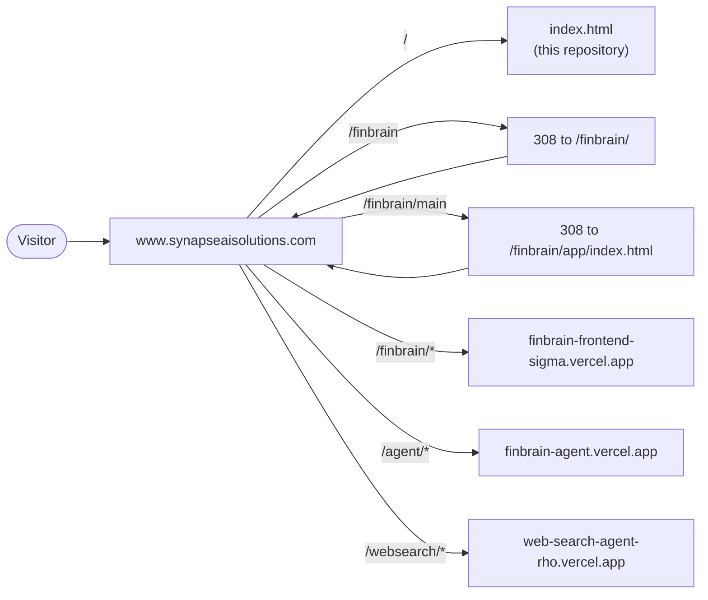
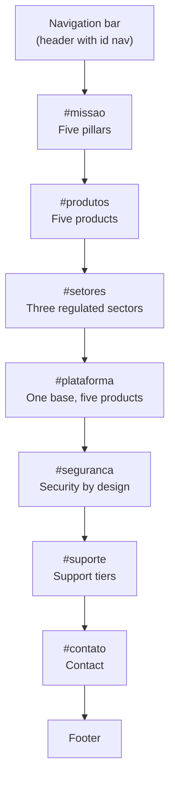
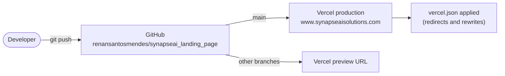

# SynapseAI Solutions: Landing Page

Static landing page for **SynapseAI Solutions**, a company that builds
domain-specific generative AI products for Finance, Education and Healthcare.
The page presents the five products, the regulated sectors served, the
platform principles, the security model, the support tiers and a contact
section.

The repository is intentionally small: one HTML file and one Vercel
configuration file. There is no build step, no framework and no package
manager.

## Contents

- [Repository structure](#repository-structure)
- [Pages and routing](#pages-and-routing)
- [Page structure](#page-structure)
- [Products](#products)
- [External dependencies](#external-dependencies)
- [Running locally](#running-locally)
- [Deployment](#deployment)
- [Making changes](#making-changes)

## Repository structure

```text
synapseai_landing_page/
├── index.html    # The whole landing page: markup, styles, images and script
└── vercel.json   # Redirects and rewrites for the /finbrain product path
```

`index.html` is self-contained. Styles are inline in a `<style>` block, the two
logos are embedded as base64 data URIs, and the only scripts loaded from
outside are the animation libraries listed in
[External dependencies](#external-dependencies).

## Pages and routing

The site is served from `www.synapseaisolutions.com`. Requests under
`/finbrain` are forwarded to the FinBrain frontend, which is deployed in a
separate repository. The FinBrain agents are also forwarded, so the FinBrain
app works on this domain.



The rewrites match the order in `vercel.json`. The specific `/finbrain/` and
`/finbrain/main` rules come before the generic `/finbrain/:path*` rule, so the
prefix is removed only where the FinBrain frontend expects it.

## Page structure

`index.html` is a single page with a navigation bar at the top and seven
anchored sections.
Each navigation link points to an anchor on the same page.



| Anchor       | Section                         | Purpose                                              |
|--------------|---------------------------------|------------------------------------------------------|
| `#missao`    | Five pillars                    | Company principles: domain focus, private data, compliance, scale, explainability |
| `#produtos`  | Five products                   | One card per product, with a link to its application |
| `#setores`   | Three regulated sectors         | Finance, Education and Healthcare use cases          |
| `#plataforma`| One base, five products         | Shared platform behind the products                  |
| `#seguranca` | Security by design              | Security and compliance practices                    |
| `#suporte`   | Support tiers                   | Support levels offered to customers                  |
| `#contato`   | Contact                         | Contact call to action                               |

## Products

| Product          | Area                              | Link in the page                               |
|------------------|-----------------------------------|------------------------------------------------|
| FinBrain         | Financial analysis and risk management | `/finbrain` (served by the FinBrain frontend) |
| RiskGen          | Risk                              | `https://riskgen.synapseai.com`                |
| EduMentor AI     | Education                         | `https://edumentor.synapseai.com`              |
| CourseGen Studio | Education                         | `https://coursegen.synapseai.com`              |
| ClinicaGPT       | Healthcare                        | `https://clinicagpt.synapseai.com`             |

The FinBrain card is the only one routed through this repository's
`vercel.json`. The other four products link to their own subdomains, which are
not part of this repository.

Other links in the page point to `https://www.synapseai.com`,
`https://docs.synapseai.com` and `https://api.synapseai.com`.

## External dependencies

| Dependency          | Loaded from                                                        | Used for                         |
|---------------------|--------------------------------------------------------------------|----------------------------------|
| Google Fonts        | `fonts.googleapis.com`, `fonts.gstatic.com`                        | Unbounded, JetBrains Mono, Inter |
| GSAP 3.12.5         | `cdnjs.cloudflare.com/ajax/libs/gsap/3.12.5/gsap.min.js`           | Animations                       |
| ScrollTrigger 3.12.5| `cdnjs.cloudflare.com/ajax/libs/gsap/3.12.5/ScrollTrigger.min.js`  | Scroll-based animations          |
| Lenis 1.1.13        | `cdn.jsdelivr.net/npm/lenis@1.1.13/dist/lenis.min.js`              | Smooth scrolling                 |

The content is plain HTML, so it is still readable without these libraries;
only the animations depend on them.

## Running locally

No build is needed. Open the file in a browser, or serve the folder with any
static server, for example:

```bash
python -m http.server 8000
```

Then open `http://localhost:8000/`. The `/finbrain` routes are defined in
`vercel.json`, which only Vercel reads, so they do not work with a plain local
server. To check the FinBrain redirects, deploy the repository to Vercel as a
preview.

## Deployment

The site is deployed on [Vercel](https://vercel.com) with the **Other**
framework preset: no build command and no output directory, because the
repository root is served as is.



The apex domain `synapseaisolutions.com` answers with a 308 redirect to
`www.synapseaisolutions.com`. That redirect is not configured in this
repository's `vercel.json`, so it is set in the domain settings of the hosting
account.

## Making changes

- Edit `index.html` directly. Keep the section anchors (`#missao`,
  `#produtos`, `#setores`, `#plataforma`, `#seguranca`, `#suporte`,
  `#contato`), because the navigation links depend on them.
- If you add or change a FinBrain route, update both the rewrites and the
  redirects in `vercel.json`. Keep the specific `/finbrain/main` and
  `/finbrain/` rules before the generic `/finbrain/:path*` rule.
- If you change where the FinBrain frontend is deployed, update the rewrite
  destinations in `vercel.json`. The current destinations are:
  - `https://finbrain-frontend-sigma.vercel.app`
  - `https://finbrain-agent.vercel.app`
  - `https://web-search-agent-rho.vercel.app`
- Check the page at phone width (around 360 to 390px) and at desktop width
  (1440px) before publishing.
- There are no automated tests in this repository. Verify the change in a
  Vercel preview deployment.
